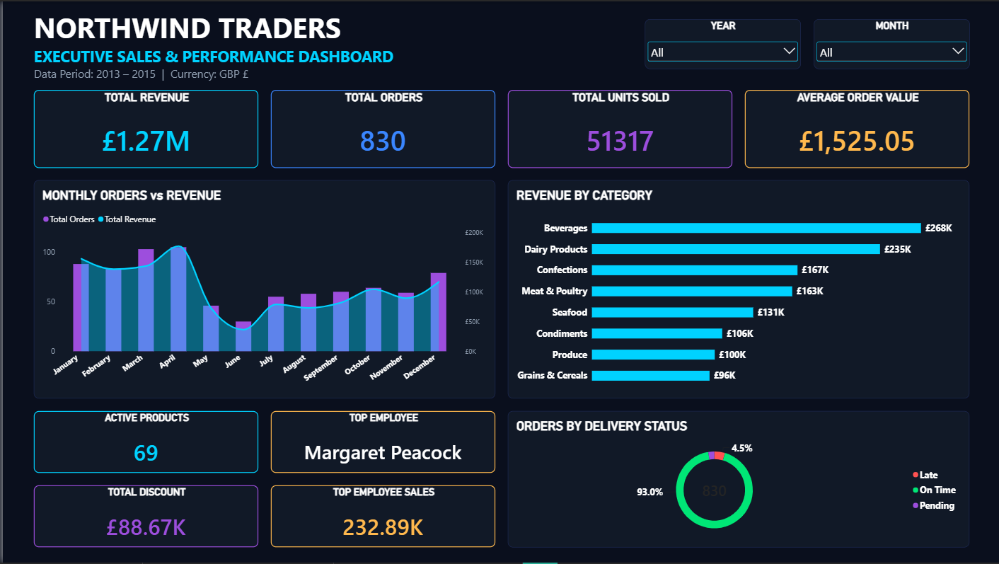
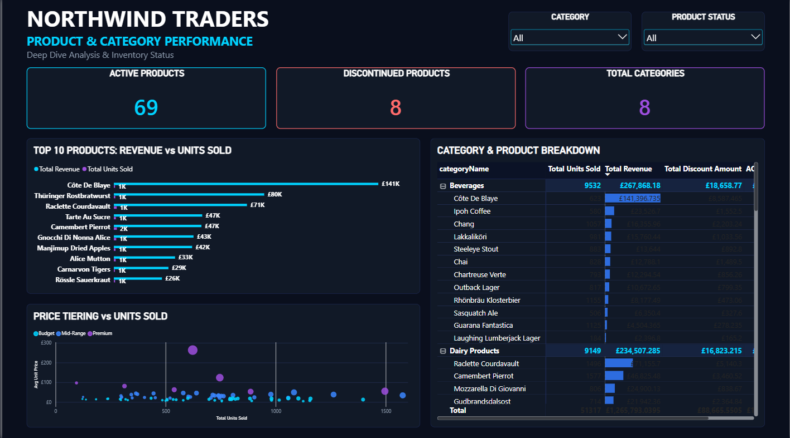
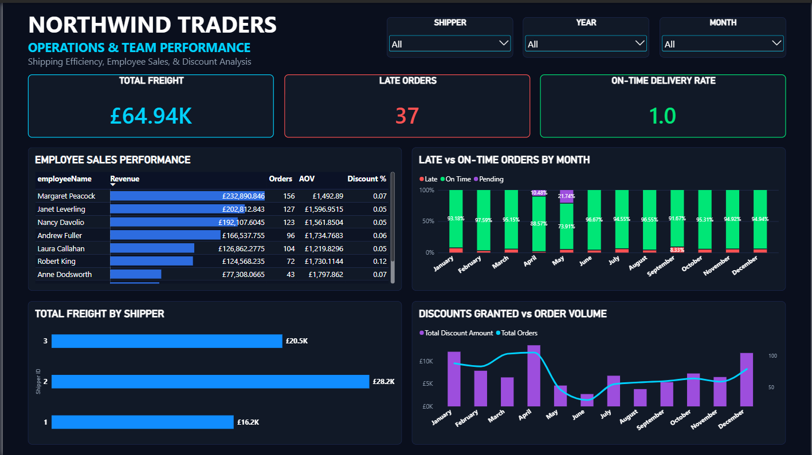
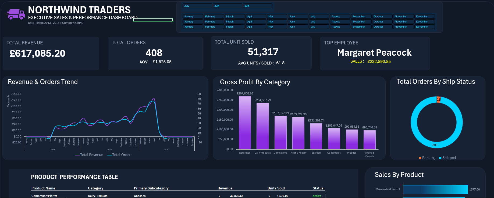
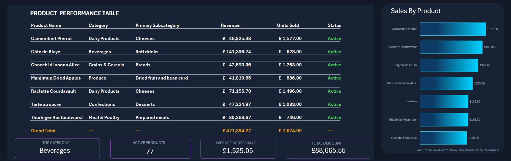

# Northwind Traders — Sales & Operations Dashboard

An end-to-end sales, product, and logistics analysis of the **Northwind Traders** dataset (July 2013 – May 2015), built twice: once as a 3-page interactive report in **Power BI** and once as an executive workbook in **Microsoft Excel** using Power Query and Power Pivot.

---

## Project Snapshot

| Metric | Value |
| :--- | :--- |
| **Net Revenue** | £1,265,793 |
| **Total Orders** | 830 (across 91 customers in 21 countries) |
| **Total Units Sold** | 51,317 |
| **Average Order Value (AOV)** | £1,525 |
| **Total Discounts Granted** | £88,666 (6.55% of gross sales) |
| **On-Time Delivery Rate** | 95.4% of shipped orders (772 on-time / 37 late / 21 pending) |
| **Total Freight Cost** | £64,943 |

---

## Dashboard Previews

> *Screenshots of the Power BI report pages and the Excel executive dashboard (replace the filenames below with your actual images inside the `Images/` folder).*

### 1. Executive Overview (Power BI)


### 2. Product & Category Performance (Power BI)


### 3. Operations & Team Performance (Power BI)


### 4. Excel Executive Dashboard



---

## What's Inside Each File

### Power BI Report (`data_analysis_project_dashboard.pbix`)
Split into three focused views with cross-filtering slicers (Year, Month, Category, Product Status, and Shipper):
* **Executive Overview:** Top-line KPI cards, monthly orders vs. revenue trend, revenue by category, delivery status split, and top salesperson callout.
* **Product & Category Performance:** Active vs. discontinued product tracking (69 active, 8 discontinued), Top 10 products comparing revenue against volume, a price-tier vs. units-sold scatter plot, and a drill-down category/product matrix.
* **Operations & Team Performance:** Freight breakdown by shipper, monthly on-time vs. late delivery ratio, discount volume vs. order count, and an employee scorecard (Revenue, Orders, AOV, and Discount %).

### Excel Workbook (`Northwind_Executive_Dashboard_Done.xlsx`)
Built for stakeholders who prefer working directly in spreadsheets:
* **`Dashboard`:** Interactive KPI cards, PivotCharts, and Year/Month slicers.
* **`Pivot_Calc`:** Back-end PivotTables feeding the visual layer.
* **`Readme`:** In-file data dictionary, model summary, and DAX documentation.

---

## Data Preparation & Modeling

The raw data came as 7 separate CSV tables (`orders`, `order_details`, `products`, `categories`, `customers`, `employees`, and `shippers`).

1. **Cleaning (Power Query):** Trimmed text fields, handled missing `shippedDate` values (21 pending orders), split category descriptions into subcategories, and derived delivery performance (`On-Time`, `Late`, `Pending`), product status (`Active` / `Discontinued`), and price tiers. In Excel, staging queries were loaded as *Only Create Connection* to keep the workbook lightweight.
2. **Data Model (Star Schema):** Structured around two fact tables (`orders`, `order_details`) linked to dimension tables (`products`, `categories`, `customers`, `employees`, `shippers`) plus a dedicated `Calendar` table for time-based filtering.
3. **Core DAX Measures:**
   * `Total Revenue` = `SUM(order_details[LineTotal])`
   * `Total Orders` = `DISTINCTCOUNT(orders[orderID])`
   * `Total Units Sold` = `SUM(order_details[quantity])`
   * `AOV` = `DIVIDE([Total Revenue], [Total Orders], 0)`
   * `Total Discount Amount` = `SUMX(order_details, [unitPrice] * [quantity] * [discount])`
   * Plus shipping and operational KPIs (`Total Freight`, `Late Orders`, `On-Time Delivery Rate`, `Top Employee Sales`).

---

## Key Findings

* **Two categories drive almost 40% of revenue:** Beverages (£267.9K, 21.2%) and Dairy Products (£234.5K, 18.5%) lead all eight categories, while Grains & Cereals (£95.7K) and Produce (£100.0K) sit at the bottom.
* **High-price vs. high-volume products:** *Côte de Blaye* is the #1 revenue generator at £141.4K despite selling only 623 units. On the volume side, *Camembert Pierrot* leads with 1,577 units sold (£46.8K), while *Raclette Courdavault* performs strongly on both fronts (£71.2K across 1,496 units).
* **Sales concentration in the top 3 reps:** Margaret Peacock (£232.9K, 156 orders), Janet Leverling (£202.8K, 127 orders), and Nancy Davolio (£192.1K, 123 orders) account for nearly half of company revenue.
* **Shipping reliability & bottleneck:** Overall on-time delivery is solid at 95.4% of shipped orders, with only 37 late shipments. **United Package** handles the heaviest workload (326 orders, £28.2K in freight) and also accounts for the highest share of late deliveries (16 of the 37).
* **Strong growth into 2015:** Revenue reached £617.1K across all of 2014 (408 orders), and by early May 2015 had already hit £440.6K (270 orders) — putting 2015 well ahead of the prior year's pace.

---

## Repository Structure

```text
├── Dataset/
│   ├── categories.csv
│   ├── customers.csv
│   ├── employees.csv
│   ├── order_details.csv
│   ├── orders.csv
│   ├── products.csv
│   └── shippers.csv
├── Images/
│   ├── 01_executive_overview.png
│   ├── 02_product_category.png
│   ├── 03_operations_team.png
│   └── 04_excel_dashboard.png
├── data_analysis_project_dashboard.pbix
├── Northwind_Executive_Dashboard_Done.xlsx
└── README.md
